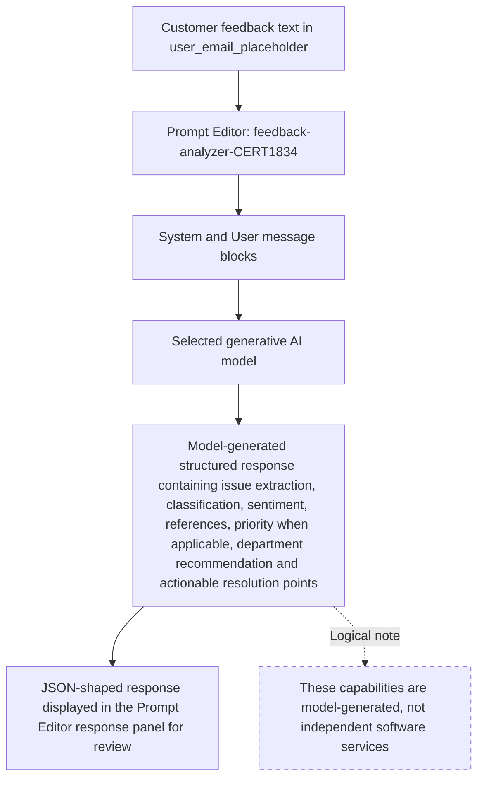

# Project Architecture

## 1. Purpose and Scope

This document describes the architecture supported by the repository evidence for the SAP Generative AI-Based Customer Feedback Analysis and Issue Prioritization System.

The repository is a documentation and evidence project. It is not an executable application, deployed service, or production-ready implementation. It contains:

- Assessment instructions.
- SAP AI Launchpad Prompt Editor screenshots.
- Evidence-based prompt, schema, test-case, and model-comparison documentation.
- A certificate.

This document distinguishes:

- **Assessment requirement** — a workflow or schema requirement stated in the assessment PDF.
- **Screenshot evidence** — an activity or response visibly demonstrated by a repository screenshot.
- **Conceptual description** — a logical interpretation of the documented prompt workflow that is not implemented by repository code.

The repository does not provide source code, API integration code, database configuration, backend services, deployment artifacts, authentication configuration, or automated processing components.

## 2. System Context

The supported system context is a prompt-based workflow in SAP AI Launchpad:

| Context element | Evidence-supported description |
|---|---|
| Platform | SAP AI Launchpad Prompt Editor |
| Template | `feedback-analyzer-CERT1834` |
| Scenario | `orchestration` |
| Input variable | `user_email_placeholder` |
| Model-processing context | A selected generative AI model |
| Output context | JSON-shaped model text returned in the Prompt Editor response panel |

The documented template evolves through prompt versions `1.0.0`, `1.1.0`, `1.2.0`, `2.0.0`, `2.1.0`, `2.2.0`, `3.0.0`, and `3.1.0`.

Primary evidence:

- `README.md`
- `02_Project/SAP-Generative-AI-Developer-Assessment-Task-Instructions.pdf`, Tasks 1–4, printed pp. 3–10
- `03_Screenshots/01-Gemini-2.5-Flash-Lite-Response.png`
- `03_Screenshots/04-Structured-JSON-Schema-and-Issue-Extraction.png`
- `03_Screenshots/05-Multi-Issue-Extraction-Prompt.png`

## 3. Logical Architecture Overview

The following Mermaid diagram represents the **documented Prompt Editor workflow**. It is a logical evidence model, not a deployed application architecture.

### Evidenced Prompt Editor activities

The repository visibly establishes or assesses:

1. Supplied feedback through `user_email_placeholder`.
2. Prompt template selection and version context.
3. System and User message configuration.
4. Generative AI model selection.
5. Prompt execution.
6. Visible JSON-shaped response text.

### Model-generated capabilities (not separate downstream services)

Issue extraction, prioritization, department routing, and actionable resolution recommendations are represented by model-output fields and prompt instructions. The repository does not demonstrate automatic execution of those recommendations or a downstream service that consumes the output.

No API, database, queue, backend process, orchestration service, authentication layer, or deployed integration is documented.

## 4. Customer Feedback Input

The `user_email_placeholder` variable is the documented Prompt Editor input variable for the customer feedback message.

Evidence:

- Assessment PDF, Task 1.1, printed pp. 3–4.
- Screenshot 05, which shows `{{?user_email_placeholder}}` in the User prompt.
- `PROMPT_DOCUMENTATION.md`, “Input Variable Definition.”

The variable supplies the customer-feedback text to the prompt for analysis. The repository documents the variable name but does not document:

- Variable data type.
- Required or optional status.
- Default value.
- Length limits.
- Validation rules.

The variable should not be interpreted as an external email-address field or a personal-communication integration. The evidence supports it as the placeholder used to insert feedback text into the prompt.

## 5. SAP AI Launchpad Prompt Editor

The Prompt Editor is the documented execution environment for the project.

The documented configuration context includes:

- Template name: `feedback-analyzer-CERT1834`.
- Scenario: `orchestration`.
- Prompt versions from `1.0.0` through `3.1.0`.
- System and User message blocks.
- `user_email_placeholder`.
- One selected available model at run time.

The prompt version evolution is documented as follows:

| Version | Evidence-supported purpose |
|---|---|
| `1.0.0` | Initial base prompt and single-issue JSON structure |
| `1.1.0` | Prompt-hardening requirements |
| `1.2.0` | Save baseline output in the Assistant role |
| `2.0.0` | Add `Actionable_Resolution_Points` |
| `2.1.0` | Save the extended output in the Assistant role |
| `2.2.0` | Save the selected model output as `Optimal Model Output` |
| `3.0.0` | Add multi-issue extraction and `Priority` |
| `3.1.0` | Capture complex multi-issue output |

The repository does not contain an exported Prompt Editor template or complete saved Assistant-role content.

Evidence sources:

- `PROMPT_DOCUMENTATION.md`
- `03_Screenshots/04-Structured-JSON-Schema-and-Issue-Extraction.png`
- `03_Screenshots/05-Multi-Issue-Extraction-Prompt.png`
- `03_Screenshots/06-Actionable-Resolution-Points-Output.png`

## 6. Prompt and Model Processing

### System instructions

The screenshot evidence shows a System role that defines the assistant as an enterprise customer-feedback analysis assistant. Its purpose is to analyze customer emails and extract information for departmental routing.

Visible prompt-hardening instructions include:

- Do not change required JSON keys, data types, or permitted enum values.
- Use only information supported by the customer email.
- Do not invent missing details.
- Preserve order references exactly as written, including symbols such as `#`.

These fragments are partial where the surrounding prompt text is not visible.

### User instructions

The visible User instructions analyze the supplied customer email and request extraction of:

- Main issue.
- Sentiment.
- Concise issue summary.
- Order reference.
- Product reference.
- Most appropriate department.

The multi-issue User instruction asks the model to identify distinct issues, individual sentiment and priority, and overall customer sentiment.

### Model selection

The repository contains one visible response for each of:

- `Gemini 2.5 Flash Lite (001)` — screenshot 01.
- `GPT-4.1 nano (2025-04-14)` — `03_Screenshots/02-GPT-4.1-nano-Response.png`.
- `GPT-5-Mini (2025-08-07)` — `03_Screenshots/03-GPT-5-Mini-Response.png`.

The screenshots show only parameter counts:

- Gemini: `Parameters (3)`.
- GPT-4.1 nano: `Parameters (5)`.
- GPT-5-Mini: `Parameters (2)`.

Parameter names and values are not visible. The repository does not establish a formal benchmark or define an implemented model-routing mechanism.

## 7. Structured Response Format

The model responses are JSON-shaped text displayed in the SAP AI Launchpad Prompt Editor response panel. The repository does not contain a separate parser, validator, backend component, or application that processes this text.

JSON-shaped screenshot output is evidence of displayed text only. It does not prove automated JSON parsing or validation.

### Initial single-issue structure

The initial assessment-defined structure has seven fields:

1. `Feedback_ID`
2. `Main_Category`
3. `Customer_Sentiment`
4. `Issue_Summary`
5. `Order_Reference_ID`
6. `Product_Reference`
7. `Suggested_Department`

Supported values are:

- `Main_Category`: `Product Issue`, `Delivery Problem`, `Return/Refund`, `General Inquiry`, `Website/App Issue`, `Account Issue`.
- `Customer_Sentiment`: `Very Negative`, `Negative`, `Neutral`, `Positive`, `Very Positive`.
- `Suggested_Department`: `Customer Service`, `Product Team`, `Logistics`, `Returns Processing`, `Technical Support`.

`N/A` is supported only for missing `Order_Reference_ID` and `Product_Reference`. The available evidence does not define nullability or additional JSON Schema constraints.

### Actionable-resolution extension

Prompt version `2.0.0` adds `Actionable_Resolution_Points`, an array of strings containing 1–3 distinct, concise points.

### Multi-issue extension

Prompt version `3.0.0` evolves the structure into a header and issue array:

Header fields:

- `Feedback_ID`
- `Overall_Customer_Sentiment`

Top-level array:

- `Issues`

The exact top-level array structure is partially available and contains one issue object for each distinct issue.

Issue-level fields:

1. `Issue_ID`
2. `Main_Category`
3. `Customer_Sentiment_for_Issue`
4. `Issue_Summary`
5. `Order_Reference_ID`
6. `Product_Reference`
7. `Actionable_Resolution_Points`
8. `Priority`

Supported issue-level enum values are:

- `Customer_Sentiment_for_Issue`: `Very Negative`, `Negative`, `Neutral`, `Positive`, `Very Positive`.
- `Priority`: `High`, `Medium`, `Low`.

The repository does not provide a machine-readable JSON Schema or a complete generated multi-issue JSON response.

## 8. Issue Extraction and Classification

The prompt is intended to derive issue information from the customer-feedback text:

- Main category or per-issue category.
- Overall or per-issue sentiment.
- Concise issue summary.
- Order reference.
- Product reference.
- Distinct issue count in multi-issue messages.

In the initial structure, the summary limit is 100 words. In the multi-issue structure, each issue summary is limited to 75 words.

The assessment example for multiple issues includes:

- One defective-product issue.
- One account issue.

The repository also documents a second two-issue sample involving a broken headset and duplicate membership charge.

These extraction and classification behaviors are model-generated prompt capabilities. There is no application implementation that independently parses feedback or extracts fields.

## 9. Prioritization and Routing

### Prioritization

In the multi-issue structure, the model is instructed to generate `Priority` with one of:

- `High`
- `Medium`
- `Low`

The assessment describes priority as based on urgency, impact, and severity. It does not define a deterministic formula or an automatic prioritization service.

### Department routing

The single-issue structure includes `Suggested_Department`, with allowed values:

- `Customer Service`
- `Product Team`
- `Logistics`
- `Returns Processing`
- `Technical Support`

This is a model-generated recommendation within the response. It does not establish that any department is contacted or that a routing action is carried out.

## 10. Actionable Resolution Points

`Actionable_Resolution_Points` is a model-output array in the extended prompt schema.

The assessment requires 1–3 distinct, concise points describing:

- What the customer explicitly requests.
- What technical detail needs to be addressed for resolution.

The repository shows:

- Version `2.0.0` schema extension evidence in screenshots 05 and 06.
- Resolution points in the single-issue model-response screenshot 06.
- Resolution points for each issue in the multi-issue schema.

The array is an output recommendation. The repository does not contain execution of a resolution, communication with a customer, or an automated follow-up workflow.

## 11. Demonstrated Workflow Evidence

| Workflow area | Assessment evidence | Screenshot evidence | Demonstrated scope |
|---|---|---|---|
| Template and scenario | Tasks 1–4 | Screenshots 01–06 | Template and Prompt Editor context are visible |
| Customer-feedback input | Task 1.1 and variable requirement | Screenshot 05 | `user_email_placeholder` is visible |
| System/User instructions | Tasks 1–4 | Screenshots 01, 04, 05, 06 | Partial prompt fragments are visible |
| Single-issue schema | Task 1.1 | Screenshot 04 | Initial seven-field structure is documented and partially shown |
| Resolution points | Task 2.1 | Screenshots 05–06 | Schema and 1–3 point requirement are visible |
| Multi-issue extraction | Task 4.1 | Screenshot 05 | Header, `Issues` array, issue fields, and priority are visible |
| Model comparison | Task 3.1 | Screenshots 01–03 | Three model response panels are visible |
| Complex multi-issue test | Task 4.2 | Not fully available | Assessment sample is available; complete response is missing |

The assessment PDF is the primary source for printed requirements. Screenshot evidence confirms visible Prompt Editor configuration and response examples only.

## 12. Architecture and Evidence Boundaries

The repository does not demonstrate or implement:

- An application or runtime entry point.
- External APIs or SAP AI Core SDK integration.
- Database or persistent storage.
- Backend services or server-side processing.
- Authentication or secret management.
- Deployment configuration or infrastructure.
- Message queues or event-driven processing.
- Automated JSON parsing or schema validation.
- Deterministic field extraction outside the prompt.
- Automatic department communication.
- Automatic priority execution or escalation.
- Automated resolution actions or customer follow-up.
- A complete exported Prompt Editor template.
- Parameter names and values.
- Complete Assistant-role outputs.
- Automated model selection or model-routing logic.
- Formal benchmark scores or a verified optimal model.

The repository is therefore documentation and evidence of a prompt-engineering assessment, not a deployed customer-feedback application.

## 13. Conceptual vs Implemented Summary

| Capability | Repository evidence | Architecture status |
|---|---|---|
| Customer-feedback text input | Assessment variable and screenshots | Demonstrated Prompt Editor concept; no application ingestion component |
| Prompt template `feedback-analyzer-CERT1834` | README and screenshots | Demonstrated as a Prompt Editor template |
| `orchestration` scenario | README and screenshots | Demonstrated in Prompt Editor context |
| System and User prompt instructions | Assessment and partial screenshots | Partial prompt evidence; complete export unavailable |
| LLM model selection | Three model screenshots | Demonstrated Prompt Editor model selection; no automated model routing |
| JSON-shaped response | Response panels in screenshots | Demonstrated displayed text; no parser or validator |
| Sentiment extraction | Assessment and schema | Model-generated output field; no independent implementation |
| Category extraction | Assessment and schema | Model-generated output field; no independent implementation |
| Reference extraction | Assessment and schema | Model-generated output field; no independent implementation |
| Multi-issue extraction | Assessment and screenshot 05 | Prompt/schema capability; no complete executable workflow |
| Priority recommendation | Assessment and multi-issue schema | Model-generated output field; no priority execution |
| Department recommendation | Initial and multi-issue output definitions | Model-generated output field; no department contact or routing |
| Resolution recommendation | `Actionable_Resolution_Points` | Model-generated output field; no resolution execution |
| Automated validation | No repository implementation | Missing |
| Deployment | No repository evidence | Missing |
