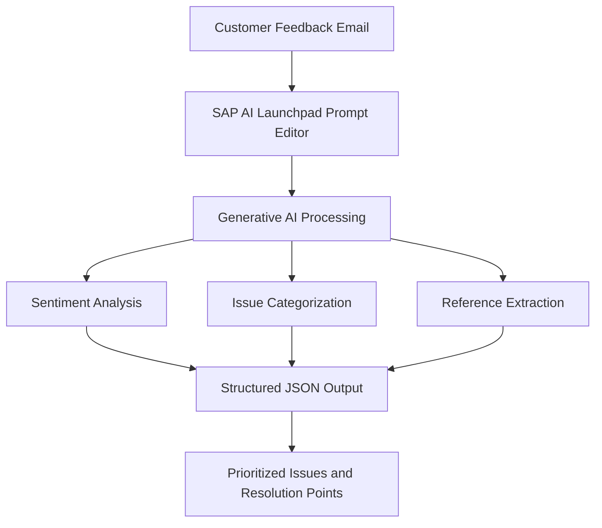

# SAP Generative AI Feedback Analyzer

<p align="center">
  **Customer Feedback Intelligence using SAP Generative AI**
  <br />
  Prompt Engineering · LLM Evaluation · Structured JSON · Issue Prioritization
</p>

<h3 align="center">
  Customer Feedback Intelligence using SAP Generative AI
</h3>

<p align="center">
  Prompt Engineering · LLM Evaluation · Structured JSON · Issue Prioritization
</p>

---

## Overview

The **SAP Generative AI Feedback Analyzer** is a prompt-engineering project developed using the SAP AI Launchpad Prompt Editor.

The project uses the `feedback-analyzer-CERT1834` prompt template in the `orchestration` scenario to analyze customer feedback emails and generate structured JSON outputs for customer-service workflows.

It identifies customer sentiment, categorizes issues, extracts order and product references, and generates actionable resolution suggestions. It also explores multi-issue extraction and compares responses from different generative AI models.

## Key Features

- **Sentiment Analysis:** Identifies the customer's sentiment from feedback.
- **Issue Categorization:** Classifies customer complaints into relevant categories.
- **Reference Extraction:** Extracts order and product references when available.
- **Multi-Issue Extraction:** Identifies multiple issues within a single customer message.
- **Issue Prioritization:** Organizes extracted issues for effective routing.
- **Actionable Recommendations:** Suggests relevant departments and resolution points.
- **Structured JSON Output:** Generates consistent, structured responses.

## Project Workflow



## Technology Stack

| Component | Technology |
|---|---|
| AI Platform | SAP AI Launchpad |
| Development Environment | Prompt Editor |
| AI Technique | Prompt Engineering |
| Output Format | Structured JSON |
| Models Evaluated | Gemini 2.5 Flash Lite (001), GPT-4.1 nano, GPT-5-Mini |

## Generative AI Model Comparison

Three models were tested using a customer feedback example involving a delivery problem.

| Model | Observed Response |
|---|---|
| Gemini 2.5 Flash Lite (001) | Included the expected structured routing fields in the shown example |
| GPT-4.1 nano | Returned a compact structured response |
| GPT-5-Mini | Produced a structured response with a more descriptive issue summary |

*Note: These are qualitative observations from the available test screenshots, not formal performance benchmarks.*

## Project Screenshots

### Model Responses

| Model | Screenshot |
|---|---|
| Gemini 2.5 Flash Lite | [View Screenshot](03_Screenshots/01-Gemini-2.5-Flash-Lite-Response.png) |
| GPT-4.1 nano | [View Screenshot](03_Screenshots/02-GPT-4.1-nano-Response.png) |
| GPT-5-Mini | [View Screenshot](03_Screenshots/03-GPT-5-Mini-Response.png) |

### Prompt Engineering and Output

| Component | Screenshot |
|---|---|
| Structured JSON Schema and Issue Extraction | [View Screenshot](03_Screenshots/04-Structured-JSON-Schema-and-Issue-Extraction.png) |
| Multi-Issue Extraction Prompt | [View Screenshot](03_Screenshots/05-Multi-Issue-Extraction-Prompt.png) |
| Actionable Resolution Points Output | [View Screenshot](03_Screenshots/06-Actionable-Resolution-Points-Output.png) |

## Skills and Learning Outcomes

Through this project, I explored:

- Designing effective prompts for structured generative AI outputs.
- Extracting information from unstructured customer feedback.
- Applying sentiment analysis and issue categorization using LLMs.
- Handling multiple issues within a single customer message.
- Comparing different LLM responses for a defined task.
- Refining prompts to improve the consistency of JSON outputs.
- Exploring practical applications of generative AI in customer-service workflows.

## Certification

**SAP Certified – SAP Generative AI Developer**

- [View Certificate (PDF)](01_Certificate/SAP-Generative-AI-Developer-Certificate.pdf)
- [Verify Certification on Credly](https://www.credly.com/badges/8a5f8129-4b14-4918-8d71-1a2550539478/public_url)

## Repository Structure

```text
SAP-Generative-AI
