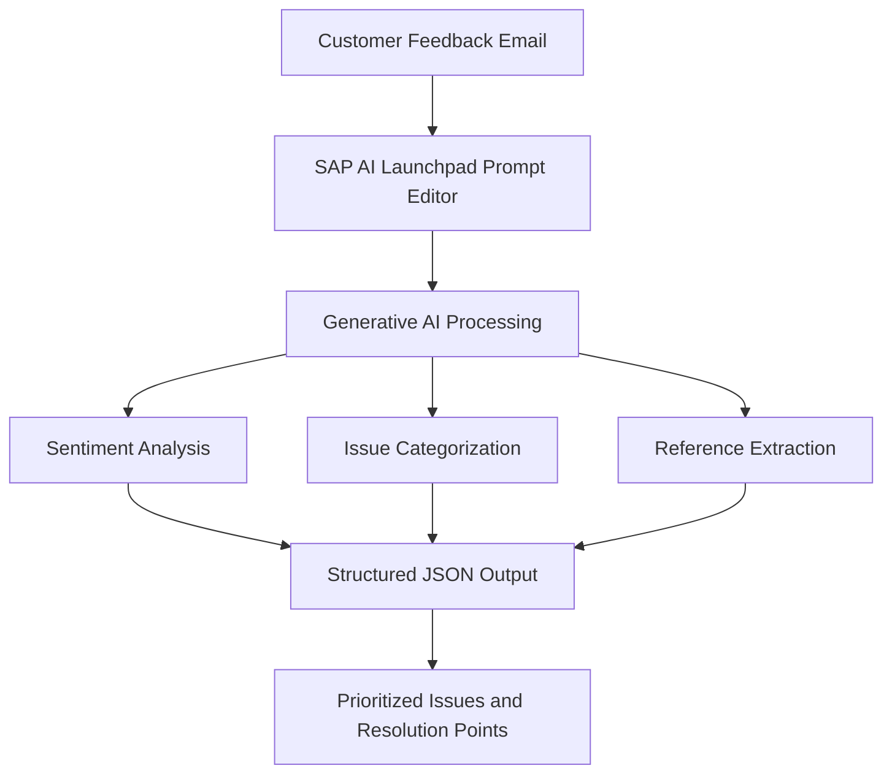

# SAP Generative AI Feedback Analyzer

<h3 align="center">
  Customer Feedback Intelligence using SAP Generative AI
</h3>

<p align="center">
  Prompt Engineering · LLM Evaluation · Structured JSON · Issue Prioritization
</p>

<p align="center">
  <a href="https://www.credly.com/badges/8a5f8129-4b14-4918-8d71-1a2550539478/public_url">
    Verify SAP Certification on Credly
  </a>
  &nbsp;·&nbsp;
  <a href="01_Certificate/SAP-Generative-AI-Developer-Certificate.pdf">
    View Certificate PDF
  </a>
</p>

---

## Overview

The **SAP Generative AI Feedback Analyzer** is a prompt-engineering project developed with the SAP AI Launchpad Prompt Editor. It explores how generative AI can transform unstructured customer feedback into structured information that supports customer-service analysis and routing.

The project uses the `feedback-analyzer-CERT1834` prompt template in the `orchestration` scenario to analyze customer feedback emails and produce structured JSON outputs. The documented workflow covers sentiment analysis, issue extraction, prioritization, routing recommendations, and actionable resolution points.

This repository contains project documentation and visual evidence from the prompt-engineering work. It is **not an executable application** and does not include an API service, command-line tool, exported prompt implementation, or deployment configuration.

## Architecture and Workflow

The documented architecture is a prompt-based workflow hosted in SAP AI Launchpad:

1. A customer feedback email is provided as input to the prompt workflow.
2. The SAP AI Launchpad Prompt Editor applies the `feedback-analyzer-CERT1834` prompt in the `orchestration` scenario.
3. A selected generative AI model interprets the feedback.
4. The workflow identifies sentiment, categories, references, and individual issues.
5. Issues are prioritized and associated with routing and resolution recommendations.
6. The result is presented as structured JSON for customer-service workflows.

The repository documents and illustrates this workflow through the README and screenshots; it does not implement these processing steps in source code.

## Key Features

- **Sentiment Analysis:** Identifies the customer's sentiment from feedback.
- **Issue Categorization:** Classifies customer complaints into relevant categories.
- **Reference Extraction:** Extracts order and product references when available.
- **Multi-Issue Extraction:** Identifies multiple issues within a single customer message.
- **Issue Prioritization:** Organizes extracted issues for effective routing.
- **Department Routing:** Suggests the department or operational area best suited to handle an issue.
- **Resolution Recommendations:** Provides actionable resolution points based on the identified issues.
- **Structured JSON Output:** Generates consistent, structured responses.

These capabilities are demonstrated through the included prompt and model-response screenshots. They are not exposed as executable repository features.

## Project Workflow



## Technology Stack

| Component | Technology |
|---|---|
| AI Platform | SAP AI Launchpad |
| Development Environment | Prompt Editor |
| AI Technique | Prompt Engineering |
| Output Format | Structured JSON |
| Models Evaluated | Gemini 2.5 Flash Lite, GPT-4.1 nano, GPT-5-Mini |

## Generative AI Model Comparison

Three models were evaluated using a customer feedback example involving a delivery problem:

| Model | Observed Response |
|---|---|
| Gemini 2.5 Flash Lite (001) | Included the expected structured routing fields in the shown example |
| GPT-4.1 nano (2025-04-14) | Returned a compact structured response |
| GPT-5-Mini (2025-08-07) | Produced a structured response with a more descriptive issue summary |

*Note: These are qualitative observations from the available test screenshots, not formal performance benchmarks.*

## Project Screenshots

### Model Responses

| Model | Screenshot |
|---|---|
| Gemini 2.5 Flash Lite | [View Screenshot](03_Screenshots/01-Gemini-2.5-Flash-Lite-Response.png) |
| GPT-4.1 nano | [View Screenshot](03_Screenshots/02-GPT-4.1-nano-Response.png) |
| GPT-5-Mini | [View Screenshot](03_Screenshots/03-GPT-5-Mini-Response.png) |

### Prompt Engineering and Output

| Component | Screenshot |
|---|---|
| Structured JSON Schema and Issue Extraction | [View Screenshot](03_Screenshots/04-Structured-JSON-Schema-and-Issue-Extraction.png) |
| Multi-Issue Extraction Prompt | [View Screenshot](03_Screenshots/05-Multi-Issue-Extraction-Prompt.png) |
| Actionable Resolution Points Output | [View Screenshot](03_Screenshots/06-Actionable-Resolution-Points-Output.png) |

## Skills and Learning Outcomes

Through this project, I explored:

- Designing effective prompts for structured generative AI outputs.
- Extracting information from unstructured customer feedback.
- Applying sentiment analysis and issue categorization using LLMs.
- Handling multiple issues within a single customer message.
- Comparing different LLM responses for a defined task.
- Refining prompts to improve the consistency of JSON outputs.
- Exploring practical applications of generative AI in customer-service workflows.

## Certification

**SAP Certified – SAP Generative AI Developer**

- [View Certificate (PDF)](01_Certificate/SAP-Generative-AI-Developer-Certificate.pdf)
- [Verify Certification on Credly](https://www.credly.com/badges/8a5f8129-4b14-4918-8d71-1a2550539478/public_url)

## Repository Structure

```text
SAP-Generative-AI-Feedback-Analyzer/
├── 01_Certificate/
│   └── SAP-Generative-AI-Developer-Certificate.pdf
├── 02_Project/
│   └── SAP-Generative-AI-Developer-Assessment-Task-Instructions.pdf
├── 03_Screenshots/
│   ├── Model response screenshots
│   ├── Structured JSON and issue extraction screenshot
│   ├── Multi-issue extraction prompt screenshot
│   └── Actionable resolution points screenshot
└── README.md
```

- **`01_Certificate/`** — Contains the SAP Generative AI Developer certification PDF.
- **`02_Project/`** — Contains the assessment task instructions associated with the project.
- **`03_Screenshots/`** — Contains visual evidence of model responses, prompt design, structured output, multi-issue extraction, and resolution recommendations.
- **`README.md`** — Provides the project overview, documented workflow, capabilities, model comparison, and repository guidance.

## Demonstrated Capabilities and Future Improvements

### Demonstrated in this repository

- Prompt-based customer feedback analysis in SAP AI Launchpad.
- Sentiment analysis and issue categorization.
- Order and product reference extraction.
- Extraction and prioritization of multiple issues.
- Department routing and resolution recommendations.
- Structured JSON response generation.
- Qualitative comparison of Gemini 2.5 Flash Lite, GPT-4.1 nano, and GPT-5-Mini.

### Proposed future improvements

The following items are potential next steps and are not implemented in this repository:

- Export the prompt and JSON schema in machine-readable form.
- Add a reproducible application or API integration.
- Add automated validation and tests for structured model output.
- Define evaluation datasets and formal comparison criteria.
- Add safeguards for malformed output, prompt injection, and sensitive customer data.
- Add deployment, monitoring, and secret-management configuration.
